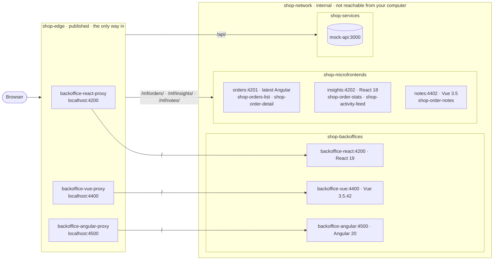
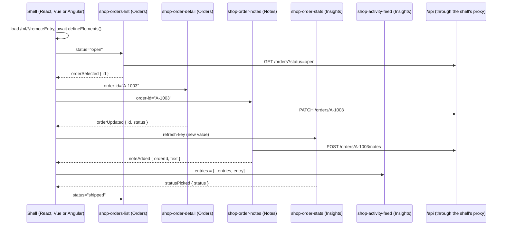

# Web Components & Micro-Frontends

> **Part 2 of 5** in [Micro-Frontend Laboratory](https://github.com/micro-frontend-laboratory)
> ← [web-components-fundamentals](https://github.com/micro-frontend-laboratory/web-components-fundamentals) · module-federation-react (coming soon) →

**One online shop back office. Three frameworks. One contract: the custom element.**

> [`polyglot-microfrontends`](https://github.com/micro-frontend-laboratory/polyglot-microfrontends)
> is the companion repository of the talk *Web Components & Micro-Frontends*.
> Every micro-frontend demo from the talk runs from here, and [docs/showcase.md](docs/showcase.md)
> is the script it follows.

## Micro-frontends calling each other

Three teams ship their features as custom elements, each with its own framework, and each runs
its own server:

| App | Framework | Exports |
| --- | --- | --- |
| [`apps/microfrontends/orders`](apps/microfrontends/orders) | latest Angular | `<shop-orders-list>`, `<shop-order-detail>` |
| [`apps/microfrontends/insights`](apps/microfrontends/insights) | React | `<shop-order-stats>`, `<shop-activity-feed>` |
| [`apps/microfrontends/notes`](apps/microfrontends/notes) | Vue | `<shop-order-notes>` |

Three shells load them at runtime, through Native Federation and Module Federation, and put all
of them on one page: [`backoffice-react`](apps/backoffices/backoffice-react),
[`backoffice-vue`](apps/backoffices/backoffice-vue) and
[`backoffice-angular`](apps/backoffices/backoffice-angular). Every shell brings its own
framework, at its own version, and so does every micro-frontend: the React 19 shell hosts React 18
components, the Vue 3.5.42 shell hosts Vue 3.5.44 components, and the Angular 20 shell hosts the
latest Angular. No app imports another app's code, and a new release of a remote reaches every shell at the next page
load. They meet only through the custom element contract, the one
[web-components-fundamentals](https://github.com/micro-frontend-laboratory/web-components-fundamentals)
builds by hand:

```html
<shop-orders-list status="open"></shop-orders-list>
```

```js
await defineElements();
list.addEventListener('orderSelected', (event) => {
  detail.setAttribute('order-id', event.detail.id);
});
```

## How it fits together

Every app is its own server, and the servers form four groups, one Docker Compose project each,
the way separate teams would own them. Only the edge is published: one proxy per back office, on
its own port. Everything else lives on `shop-network`, an internal Docker network the browser
never reaches. Each proxy serves its shell at `/` and fetches the remotes and the API by their
Docker DNS names, so everything a page loads comes from that site and from our own servers:



| Group | Compose file | Contains | Published |
| --- | --- | --- | --- |
| `shop-services` | `compose.services.yaml` | `mock-api`; creates `shop-network` | nothing |
| `shop-microfrontends` | `compose.microfrontends.yaml` | `orders`, `insights`, `notes` | nothing |
| `shop-backoffices` | `compose.backoffices.yaml` | the three shells | nothing |
| `shop-edge` | `compose.edge.yaml` | one nginx proxy per shell, from `tools/edge` | 4200, 4400, 4500 |

The shell loads each remote's `remoteEntry` from its own site (`/mf/orders/remoteEntry.json`),
and the elements call `/api` on the same site. The proxy forwards both inside the network.

On the page, a shell and its elements talk only through the custom element contract: the shell
sets attributes and properties, the elements answer with `CustomEvent`s. Elements never talk to
each other directly; the shell listens and passes the news on:



The full contract (tags, attributes, events, theme tokens) is in
[docs/architecture.md](docs/architecture.md#contracts).

## Repository layout

```text
apps/
  microfrontends/           the apps that export custom elements
    orders/                 latest Angular
      contract/             @shop/orders-contract
    insights/               React 18
      contract/             @shop/insights-contract
    notes/                  Vue 3.5
      contract/             @shop/notes-contract
  backoffices/              the shells that host them
    backoffice-react/       React 19
    backoffice-vue/         Vue 3.5.42
    backoffice-angular/     Angular 20
  services/                 the back-end services the elements call
    mock-api/               the orders REST API
      contract/             @shop/api-contract
tools/
  edge/                     one nginx proxy per back office: serves the site, forwards /mf/ and /api/
  scripts/                  Windows shortcuts around docker compose
docs/                       architecture, demo script, one guide per app
```

Every folder is its own npm project with its own `package.json`, as if a different team owned
each one. Each team publishes what others may use as a types-only contract package in its own
folder, and the other apps install it from there (`npm install <folder>`), with no registry. See
[docs/architecture.md](docs/architecture.md#contracts).

## Run it

You only need [Docker Desktop](https://www.docker.com/products/docker-desktop/). No Node.js,
no Angular CLI, no version manager: every app builds and runs in its own container.

```bash
git clone https://github.com/micro-frontend-laboratory/polyglot-microfrontends.git
cd polyglot-microfrontends
```

Start the groups in this order; `shop-services` creates the network the others join:

```bash
docker compose -f compose.services.yaml up --build --detach --wait
docker compose -f compose.microfrontends.yaml up --build --detach --wait
docker compose -f compose.backoffices.yaml up --build --detach --wait
docker compose -f compose.edge.yaml up --build --detach --wait
```

Docker Desktop shows each group on its own. Stopping one group stops only that team's part:
stop `shop-microfrontends` and the back offices stay up and show an error card per remote.
`docker compose -f compose.services.yaml up -d --force-recreate mock-api` puts the orders back to
their starting state after a demo.

| Open | Project |
| --- | --- |
| `http://localhost:4500/orders` | `apps/backoffices/backoffice-angular` |
| `http://localhost:4400/orders` | `apps/backoffices/backoffice-vue` |
| `http://localhost:4200/orders` | `apps/backoffices/backoffice-react` |

Only these three ports are published, one per edge proxy. The
micro-frontends, the shells and `mock-api` have no port on your computer; each proxy reaches them
by name on the internal `shop-network`. `/api/` answers only the pages' own `fetch` calls;
opening it in the address bar or with curl returns `403`.

### Windows shortcuts

Double-click a script in `tools/scripts`, or run it from any folder in a terminal. Each one runs
the `docker compose` commands for you and leaves the terminal where it was.

| Script | What it does |
| --- | --- |
| `start-all.bat` | Builds and starts the four groups in order and waits until all are healthy |
| `live-all.bat` | Starts every group with Compose Watch, one window per group: saved edits reach the containers at once |
| `microfrontends/deploy-mf-orders.bat`, `deploy-mf-insights.bat`, `deploy-mf-notes.bat` | Rebuilds and restarts one micro-frontend from the current source; everything else keeps running |
| `backoffices/deploy-backoffice-react.bat`, `deploy-backoffice-vue.bat`, `deploy-backoffice-angular.bat` | The same for one back office |
| `services/deploy-mock-api.bat` | The same for the API; the orders and notes go back to the seed data |

Stop and start single containers, or all of them, from Docker Desktop.

## Tech stack

| Layer | Technology |
| --- | --- |
| Contract | Custom elements: attributes, properties, `CustomEvent`s |
| Styling | Shadow DOM and `--shop-*` CSS custom properties set by each shell |
| Loading | Native Federation (Angular), Module Federation (React, Vue), from each remote's own server. Every shell loads both with the same two runtimes: `@softarc/native-federation-orchestrator` and `@module-federation/runtime` |
| Safety | `textContent` everywhere, one error card per remote |
| Code style | Strict TypeScript, ESLint and oxlint, VS Code's built-in formatters |

## Go deeper

Here every remote brings its own copy of its framework, on purpose. The next question is how
remotes share a library instead, and the next two parts of the laboratory will answer it:

| Repository | What it covers |
| --- | --- |
| module-federation-react (coming soon) | React remotes sharing React: share scopes and version conflicts |
| native-federation-angular (coming soon) | An Angular host and Angular remotes sharing Angular |
